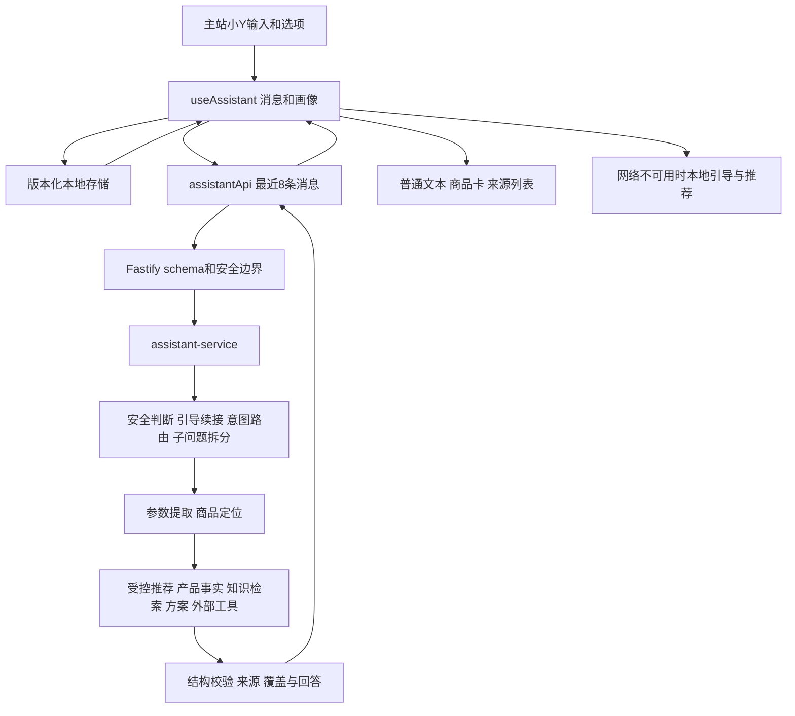

# 小Y智能体优化第一阶段：能力基线与实施范围

问题编号：**YAS-2026-0069**。本轮仅完成现状核验、基线测试、问题复现与范围登记，**阶段一已完成人工审核，未进入第二阶段**。这不是整个智能体优化完成，也不是新 ARCH 阶段。所有时间均为北京时间。

## 1. 版本、授权与证据边界

- 开始：2026-11-28 22:52:02。22:52:18 成功执行 `git fetch origin dev` 并核对实际远端；分支 `dev`，HEAD、origin/dev、实际远端均为 **`cdb8ace1bf0b98079cf254531ab620966244ef2f`**。起始工作树、暂存区干净。
- `arch-stage-14` 本地/远端对象为 `2e09f6ffc64b6f742e62caf0de5971f2feb63f01`，指向 `f65780588b96de71c8ff79c81c2a9c333fa266f5`。ARCH-14 保持 done，无新的 ARCH current，不新建或复用标签。
- 检索文档/代码/测试中的 YAS 编号及 `git log --all --grep=YAS-2026-0069`，开始时最高已见0068，0069未占用，故登记本号；不依据上次短 SHA 假定基线。
- 近期相关提交已核对：普通文本/肤质修复 `b03218e125a01235ddff2072fac0a8547af2fa3b`；通用兜底 `b4d1e49837167a86c67cf43f278d51aeceb5a720`。当前 cdb8ace 还包含0068移动店景改动，本轮不改它。
- 已阅读当前 AGENTS、FINAL-PROMPT、README、迁移计划及两累计报告最新相关记录。迁移计划首页“最近核对/验证”仍停在11月27日/26日，与当前 Git 事实不同；本次更新当前摘要并保留历史。README包含带历史阶段语境的旧 busy/存储说明，不能代替当前Hook事实。
- 首轮 Git 因进程环境的 `GIT_CONFIG_COUNT` 与缺失 `GIT_CONFIG_KEY_0` 不匹配失败。只在本次命令进程设置 `$env:GIT_CONFIG_COUNT='0'` 后成功；未改全局/仓库Git配置、凭据或TLS。
- Node 24.18.0、npm 11.16.0；使用已有 Vitest、Playwright 与 Chrome，无安装、依赖更新或模型/搜索真实调用。
- 本轮没有暂存、提交、推送、标签、stash、分支切换或删除；没有新的提交SHA或版本回退点。没有业务代码、提示词、产品/知识条目、API、依赖、存储Key变更。

## 2. 当前能力与数据流



| 位置 | 已有能力和实际数据 | 边界、丢失点 |
|---|---|---|
| `src/features/assistant/components/XiaoYAssistant.jsx` → `hooks/useAssistant.js` | 组合输入、画像、消息、工作台；Hook持有messages/profile/busy/mode，refs保存同步发送锁、最新消息、已完成问题ID | 不是独立任务状态仓库；不能把“有消息历史”当作任意任务均可恢复 |
| `profileUtils.js` | 明确自述、预算、妆效等规则；已有第三人称/假设保护；引导点选和观察轮次不写长期画像 | 保护主要基于当前句；跨轮帮朋友任务可能污染自己的预算/妆效；朋友的临时肤质又可能未取代自己的筛选条件 |
| `assistantApi.js` / `lib/api/client.js` | 同源POST `/api/assistant`；传query/profile，历史末8条、每条4000字符、助手商品ID最多3；question与beginnerContext保留 | 不传历史sources、coverage、knowledgeEvidence、dialogueDecision；没有客户端定时取消/自动重试；字符限额不能保证64KiB字节限额 |
| `server/app.cjs` / `server/schemas.cjs` | 请求/响应schema，64KiB请求体限制、速率与日额度、安全头、稳定错误；服务端统一provider | 本轮注入合成provider，不验证真实密钥/额度/供应商可达性 |
| `assistant-service.cjs` | 先处理安全与现有肤质/入门续接，再检查首次引导，之后拆分/路由；保留产品、方案、知识和外部问题职责 | 首次引导会抢占某些普通知识问题；编排中仍有天气专用分支/provider，是已存在的目标架构差异，本轮不迁移 |
| `assistant/intent-router.cjs` | 规则快速路由，未命中可进入external_question；保留必要产品澄清、安全处理 | 目前不是每次未知意图都另调模型分类；不要把历史按需分类描述为本轮仍运行的通用路径 |
| `assistant/parameters.cjs` | 当前句 + 保存画像；单次修正可读最近一条用户请求；guided initialQuery与updates按序合并；beginner进度带有限条件快照 | 普通推荐仅回看最近用户句；连续改条件中前一句不再像推荐时更早条件丢失。引导并非完全没有条件保存能力 |
| `assistant/product-resolver.cjs` | 受控名称/品牌/版本、最近助手商品ID、第二款/前后款/都可以；歧义时澄清 | 只读紧邻助手，不越过术语回答；“第二个”不等价于现有“第二款”模式；不能盲目扩大历史扫描 |
| `guided-intake.cjs`、`skinObservation.js` | question含flowId/step/route/selections/initialQuery/updates；自由回答、跳过、纠正、五轮上限、安全优先；前后端共享观察纯函数 | 初始query最多1000字符；观察结束未必留下可长期续接的原选品任务。已有画像时重新做观察的链路未接回推荐 |
| `beginner-guidance.cjs`、`beginnerContext.js` | 目标/用时/步骤/初始条件快照；直接“继续”、刷新、旧版固定模板与一次旧失败兼容 | 读最后助手的beginnerContext；插问或切话题后不会任意找回旧进度，存在明确恢复需求缺口 |
| `server/knowledge/beauty-knowledge.cjs` | 已有受控知识检索：关键词/同义表达相关性门槛、双字片加权、主题亲和、教程/研究排序；来源、条件、限制、版本 | 非向量检索且不是“没有检索”；口语召回与否定范围仍有限；整条目装入预算，过大条目会跳过 |
| `assistant/knowledge-answer.cjs` | 单项默认3200字符/最多6条；模型只重排完整受控原句，校验失败保留本地知识 | 无相关知识可转通用；有相关但本轮预算不足保持unavailable，不绕过预算。缺口文案合并了多种原因 |
| `questions.cjs` / `compound-answer.cjs` | 最多6子问题，其余deferred；普通共享预算7200字符/8条，安全预留后6200/7；chat最多4、search最多3；合并来源编号和覆盖状态 | 重复问题也消耗预算；部分不足明确报告，不等于所有子问题完成；本次没有改拆分规则 |
| `tools.cjs`、事实/比较/研究回答模块、providers | 推荐先硬筛选再评分；商品事实从站内受控记录；搜索摘录结构校验失败仍可保留真实取得的摘要；模型不可用知识/推荐可降级 | 普通无匹配问答无模型时如实失败；检索失败不伪装实时成功；独立weather路径现存但不是本次扩展范围 |
| `assistantApi` → Hook `createMessage` → `AssistantMessages/SourceList/AssistantProduct` | 适配器接收覆盖/证据/决策；消息实际保留content、productIds、sources、question、beginnerContext；普通文本清洗与真实目录ID过滤 | Hook没有逐条保存intent、answerMode、coverage、knowledgeEvidence、dialogueDecision；内存全消息，落盘末20条。显示和历史传输丢失是不同层次 |
| `src/lib/storage/{migrations,storageClient,storageKeys}.js` | v1包装、坏JSON回退、旧Key迁移；question/进度随消息保存；重置操作受忙时锁保护 | 版本只查数值和值存在，形状未全检；未知未来版本会回退，挂载effect可能用v1覆盖未来值；读写权限异常仍可能抛出；Git回退不恢复浏览器数据 |

防重复、重试和旧按钮保护并非缺失：sendLockRef在同一渲染周期先锁；活动问题ID、有效选项、completedQuestionsRef阻止旧选项；仅末尾可重试失败保存原query/历史，刷新可重放；忙时不能重置。服务端provider已有AbortController、有限重试及错误映射，通用回答显式单次20秒、知识单次8秒、研究组织单次12秒；这不等同于客户端任意悬挂fetch都能自动解除busy。本轮未等待真实网络挂起。

## 3. 基线样本与复现结果

[40组逐轮样本表](xiaoy-agent-baseline-samples.md)逐组记录初始上下文、输入、HTTP/意图/回答模式、来源与知识ID、coverage、参数探针、保存画像/进度/商品ID、合成调用次数和耗时、分类及文件位置。完整机器输出在忽略目录 `.qa/xiaoy-baseline-0069/results.json`，正式表不依赖这些临时文件即可阅读。

新增样本复用真实Hook、API适配、Fastify inject与既有领域模块，只替换React生命周期容器、存储、网络及provider。前后端用同一三款合成目录，避免未知商品ID被前端过滤造成假缺陷；并非真实浏览器Hook运行。模型结构输出故意不合规范，以检验现有本地知识/比较降级；普通模拟文本不具备语义回答能力。**40/40是采集器完成，不是40项体验成功率。** B24/25/40的重复提问只用于预算压力，不当作更多不同知识能力计数。

### 已确认需保持的行为

- B02单次预算修正可延续原品类/排除项；真实预算不足时不虚构候选。B04紧邻比较后的“第二款”能定位；歧义情况下继续澄清。
- B07/B15/B35入门方向、目标、用时、直接继续和刷新进度可用；B12/13/14/16肤质五轮、跳过、自由纠正与已有口语自述可工作；不适时停止上妆和推荐。
- B17/B23既有知识、来源和复合覆盖有效；B24有相关知识但预算不足保持unavailable；B25/40调用/子问题上限有效。
- B26规则未命中走通用问答，无固定菜单；B27问候后知识无匹配也能通用回答，sources/evidence为空，不伪装知识依据。
- B22通用提示确实传递排除项和禁止内眼线变体要求；仅证实传递，真实模型是否每次遵守待验证。
- B28–32未配置、模拟超时、搜索失败、组织失败、离线有明确失败/降级；B33/34失败重试、重复提交和旧选项保护有效；B36已有旧Key迁移/坏JSON回退可用。
- 普通文本格式/近期对话/必要商品澄清经桌面与360px浏览器40项复验；来源链接顺序/安全属性及商品卡原对象点击经现有组件测试复验。不能把组件证据扩张为本轮完整真实商品详情浏览器验收。

### 实际复现的问题（未修复）

| 登记项 | 证据与当前实际结果 | 用户影响与边界 |
|---|---|---|
| 0069-D01 连续条件丢失 | B01/02/03：预算首改正常，下一轮妆效/场景转external_question；排除品牌后再改预算返回原被排除的b/c。parameters只回看最近用户句 | 可能要求重述条件，或给出违反先前条件的候选；不归咎于模型随机性 |
| 0069-D02 商品指代与插问 | B04直接第二款正常；B05插问术语再第二个无受控定位；B06第二款澄清 | 比较任务中断；恢复必须保留歧义保护，不直接把所有历史商品当当前对象 |
| 0069-D03 入门恢复 | B08插问知识后继续转通用回答；B09明确回到教程只重答底妆，无原步骤 | 普通插问丢进度；明确切换应退出旧任务的行为仍需保留 |
| 0069-D04 主体与画像混用 | B10自己的油皮500保持，但朋友干皮200请求仍筛油皮；B11跨轮预算200/想要哑光写入自己的画像 | 朋友选品条件错用和自己的偏好被覆盖；已有同句第三人称保护不能覆盖跨轮 |
| 0069-D05 首次引导抢占 | B18/20/21/24/25/27/40从真实欢迎消息进入路线问卷；同句经你好后走知识/通用/复合 | 近期先回答/知识无匹配修复不是完全无效，但首次入口存在偏差；旧单元用messages=[]不等价于页面欢迎消息 |
| 0069-D06 否定范围不进入知识筛选 | B21“不要讲眉毛，只问粉底怎么涂”：问候后召回mens-natural-brows等，确定性降级实际输出眉毛手法 | 用户明确排除仍被回答；不是仅“模型没遵守提示” |
| 0069-D07 口语召回及缺口解释 | B17卡粉命中；B18口语仅底妆基础；B19描述式走通用；B20经问候能命中；B24内部区分相关性/预算，但提示合并 | 已有内容未充分使用；相似表达也可能指不同现象，不能盲目全部并为卡粉；应保留不确定性 |
| 0069-D08 响应元数据丢失 | B37线上有coverage/knowledgeEvidence/dialogueDecision，消息与保存层不带这些字段；intent/answerMode未逐条保存 | 难以从保存会话解释未回答项、证据范围和任务状态；并非来源链接全部消失 |
| 0069-D09 请求字符/字节上限冲突 | B38合成12条长中文→适配器8×4000字符，96502字节，网关413/PAYLOAD_TOO_LARGE | 长历史可能阻断新请求；64KiB保护应保留，应在客户端预算设计解决，不提高安全上限掩盖 |
| 0069-D10 存储版本回退 | B39合成v2读回退，挂载后写v1欢迎替换；同v1的字符串profile被读取 | 后续存储升级/代码回退有数据覆盖风险；只模拟版本，不曾实际回退代码或操作用户数据 |
| 0069-D11 重新观察不回选品 | 现有assistant-guided-intake浏览器套件free-mixed重复失败：种子油皮/1000/柔雾；推荐个粉底→不知道自己啥肤质→鼻子油两边干，最终beauty_knowledge，无产品 | 首轮已有画像直接推荐；第二句新question.initialQuery只有“不知道自己啥肤质”，遗失原推荐；不是商品库无候选。是否每次观察后应自动恢复选品，第二阶段应明确任务切换语义 |

D11原脚本第154行要求候选，未改它或放宽期望。原失败记录在 `browser-guided-chrome.log`；忽略目录的诊断副本只加HTTP记录，第二次同断言失败见 `browser-guided-repeat.log` 与 `browser-guided-repeat/latest-diagnostic.json`。原套件未走完后续35场景，**不能称肤质浏览器36/36通过**；新40组中的部分肤质与生命周期覆盖不能替代它。

### 未复现或尚未验证

- 没有复现规则未命中必然返回固定菜单；B26与浏览器样本支持修复已存在。没有复现所有无匹配知识都失败；B27明确展示入口差异。
- 真实GLM对排除项、简短程度、术语和多轮意图的稳定质量，真实搜索相关性/网络失败/限额、真实成本/延迟均待验证。本轮不新增付费或联网调用。
- 没有新增真实天气、完整妆容方案/局部调整、实体手机、跨浏览器、公网或离线资源缓存验收；本轮full suite覆盖现有测试，不代表这些实境已测试。
- 没有声称模型会遵守模拟provider中的措辞；本轮stub超时是立即注入错误，不是测量真实超时定时器。客户端无限悬挂/存储权限拒绝保留为源码及既有单测边界，没有在真实用户浏览器复现。
- 来源支持范围和图片授权本轮未重新访问/核验；模拟商品/来源/截图绝不是新增产品事实。

## 4. 真实验证与失败记录

全部原始证据在 `.qa/xiaoy-baseline-0069/`，该目录继续被Git忽略。测试数据为合成或受控已有目录；没有读取.env、server/key.txt、真实照片、私人聊天或浏览器个人档案。浏览器使用新临时上下文/随机本机端口、模拟provider，HTTPS资源被拦截，不影响已有5174/8787服务与用户记录。

| 检查 | 本次真实结果 | 证据 |
|---|---|---|
| 初始 `npm test` | 22:54:03，118文件1652/1652，5.37秒；包含旧快照826项重复 | initial-full-test.log、test-files.txt |
| `npm test -- server/services/assistant src/features/assistant src/lib/storage server/knowledge --exclude '.qa/**'` | 22:59:06，25文件555/555，2.05秒 | targeted.log |
| `npm test -- tests/baseline/xiaoy-capabilities.test.js` | 23:04:38扩展输入后40/40，1.02秒 | diagnostic-expanded.log |
| 最终字面命令 `npm test` | 23:05:30，119文件1692/1692，4.22秒；其中旧快照59文件826项 | final-full-test.log |
| `npm test -- --exclude '.qa/**'` | 23:05:51，当前源码60文件866/866，2.74秒 = 原826 + 新40组 | current-source-test.log；最终样本表取本次results.json |
| `npm run build` | 1887模块成功，1.06秒；主JS1098.98kB、three743.28kB，原大于500kB提示保留 | build.log；后续只增测试辅助/文档，不重复冒称构建 |
| `node tests/browser/assistant-general-fallback.mjs` | Chrome，1440×900 / 360×900，共40/40；pageerror0，只有脚本预期503控制台错误；检查普通文本/必要澄清/肤质口语/失败提示，抽查手机消息和桌面观察截图 | browser-general-chrome.log、browser-general-chrome/results.json及PNG |
| `node tests/browser/assistant-guided-intake.mjs` | 首场free-mixed失败，后续未完成；加诊断记录的副本再次同样失败，见D11 | browser-guided-chrome.log、browser-guided-repeat.log |
| `git diff --check` 与新文件空白/路径检查 | 文档同步后单独记录收尾实测，不用测试通过代替差异检查 | final-review.log |

初始两个浏览器脚本因本机缺Playwright默认Chromium headless可执行文件而失败；指定已安装Chrome后general通过，guided出现上述可重复业务/任务承接差异。未安装浏览器或更改已有脚本。

新采集器首轮39/40：B38发现真实413，原脚本未捕捉异常。仅修改采集器保存错误并显式记录当前限制，未缩短输入、放宽网关或把缺陷当未来正确要求。首轮还发现前后端合成目录不一致、模拟JSON识别范围偏宽及旧按钮样本未真的进入问题；均修正测试夹具本身，保留 `diagnostic-first.log` / `results-first.json`、后续日志，不把这些夹具问题登记为产品缺陷。源码现有预期未修改。

默认Vitest会发现既有 `.qa/assistant-upload-snapshot` 中59个旧测试文件。这是环境/发现范围问题，不是新增功能覆盖；保留原快照，不改配置或清理文件。对外有效当前源码数采用60文件866项，1692仅是字面命令的真实输出。

### 可复跑命令

在仓库根目录PowerShell运行，无新增依赖：

```powershell
npm test -- tests/baseline/xiaoy-capabilities.test.js
node tests/baseline/render-xiaoy-baseline.mjs
# 上行默认只生成 .qa/xiaoy-baseline-0069/samples.md，不覆盖正式历史报告
npm test -- server/services/assistant src/features/assistant src/lib/storage server/knowledge --exclude '.qa/**'
npm test
npm test -- --exclude '.qa/**'
npm run build
$env:YAS_QA_BROWSER_EXECUTABLE='C:/Program Files/Google/Chrome/Application/chrome.exe'
$env:YAS_QA_OUTPUT_DIR='.qa/xiaoy-baseline-0069/replay-general'
node tests/browser/assistant-general-fallback.mjs
$env:YAS_QA_OUTPUT_DIR='.qa/xiaoy-baseline-0069/replay-guided'
node tests/browser/assistant-guided-intake.mjs
$env:GIT_CONFIG_COUNT='0'
git diff --check
```

本机已有playwright模块可直接解析；其他环境可依原浏览器脚本设置 `YAS_QA_PLAYWRIGHT_MODULE` 指向已有模块，不在本轮授权内安装。新样本可用 `YAS_BASELINE_OUTPUT` 指定独立输出，保留旧证据；运行 `npm test` 也会运行采集器并刷新默认机器结果，正式样本表是23:05:53快照，不自动改写。

## 5. 第二阶段建议范围（仅登记，未获实施授权）

| 建议顺序 | 建议处理事项 | 为什么优先 / 拟验收边界 |
|---|---|---|
| 1 | 明确当前任务条件与主体归属，先覆盖连续条件、朋友/本人及观察回原请求 | D01/04/11直接影响筛选正确性与保存偏好；先约定“仅本次/长期”和主动切换，不自动持久化所有信息。保留硬条件与第三人称保护 |
| 2 | 约束首次引导入口与否定内容传播 | D05/06是已有近期修复仍可触发的确定性偏差；知识问题优先回答，必要缺肤质/安全澄清保留；排除项同时约束检索与回答 |
| 3 | 受控任务恢复和商品锚点 | D02/03针对插问/明确恢复，保留直接继续、旧按钮、失败重试；不得跨无关话题猜商品或自动恢复已停止任务 |
| 4 | 用现有知识改进口语召回和预算原因区分 | D07已有内容可用，先做成组表达和负例评测；继续区分无匹配/有相关但不足，保留chat/search上限；无向量/Embedding/扩充内容依据 |
| 5 | 设计响应与存储契约的最小保留、字节预算和版本兼容 | D08–10在任何新任务状态落盘之前必须定边界：未知版本不覆盖、合法数据校验、请求字节预算、最少必要数据。不能以连续对话为由无限保存私人内容 |

建议下一阶段正式实施前，先确定上述哪几个问题形成一个可完整验收范围、对应文件白名单及存储兼容方案。当前没有授权重构状态、路由/提示词、推荐/检索规则或进入第二阶段；本表不是自动开工指令。未来目标断言应另建验收测试，不改本次历史观测以掩盖差异。

## 6. 本次文件与停止位置

| 文件 | 本轮用途 |
|---|---|
| `tests/baseline/xiaoy-scenarios.mjs`（新增） | 合成多轮输入与模式 |
| `tests/baseline/xiaoy-capabilities.test.js`（新增） | 40组跨Hook/API/服务端及存储生命周期采集 |
| `tests/baseline/render-xiaoy-baseline.mjs`（新增） | 机器证据转可读逐轮表，默认输出忽略目录 |
| `docs/xiaoy-agent-baseline-phase-1.md`（新增） | 本报告、问题与建议实施范围 |
| `docs/xiaoy-agent-baseline-samples.md`（新增） | 40组实际观测快照 |
| `docs/frontend-architecture-migration-plan.md` | 更新当前核对/验证摘要，追加独立第一阶段登记，不改旧阶段历史 |
| `docs/stage-delivery-test-report.md` | 追加目的、实际路径/验证/失败/限制/交付状态 |
| `docs/product-data-accuracy-audit.md` | 追加无数据变化与原风险继承 |

AGENTS/FINAL-PROMPT的规则及产品目标未改变，无需修改。README产品/运行架构未改变，本轮不扩写其历史说明；当前基线入口登记在迁移计划与两累计报告。未编辑视频、比赛材料或部署，不能声称其内容逐项重新验收一致；本报告只陈述运行代码实际能力与限制。

**本阶段无新增核验，继承上一条结论。** 产品、价格、规格、评分、图片、来源和授权状态不变，原pending/blocked及公开素材风险保留。没有照片处理、长期服务端记忆、真实用户数据读写或新增敏感日志。

完成第一阶段交付后停止；待负责人审阅，不提交、不推送，不进入第二阶段。实际结束时间、耗时及最终差异核对见本报告末尾收尾记录。


## 7. 收尾实测记录

2026-11-28 23:18:08（北京时间）完成本轮报告整理；从22:52:02起实际经过约26分6秒，小于约1小时目标。40组正式机器快照包含112轮记录、109次本机HTTP inject、53次模拟chat、2次模拟search，provider累计58.654ms（包含人为hold的等待，不是真实性能）。部分生命周期操作在probes中而非turns，不能用这些数量推算用户成功率。

23:17:10再次fetch/实际ls-remote，dev/HEAD/origin/dev仍为cdb8ace1bf0b98079cf254531ab620966244ef2f，arch-stage-14对象和指向与开始相同；未发现远端前进、分叉或来源不明修改。23:17:36检查精确8条授权路径、空暂存区、业务源码/依赖无差异、两累计报告保留HEAD全部正文只追加、git diff --check及cached检查通过。新增5文件另查语法、行尾、40个样本标题和新文档链接，无问题；记录在.qa/xiaoy-baseline-0069/final-review.log。补入本收尾后再执行空白/范围核对，不重跑未改变的业务测试。

所有已复现业务问题继续未修复，第二阶段未实施。未完成的真实模型/搜索、真机、完整肤质浏览器后续场景等明确保留；本轮停止于第一阶段技术检查与范围登记交付，待人工验收，未提交、未推送、未打标签。


### 2026-11-28 23:25:25（北京时间）阶段一人工审核确认

项目负责人在本会话明确回复“阶段一人工审核完毕”，据此将本阶段能力基线与实施范围交付状态记为**已完成人工审核**。该确认针对第一阶段报告、基线与范围登记，不表示已修复登记问题、整个智能体优化完成，亦不补造具体人工操作、设备或真实模型验证结果。此前“待人工验收”段落保留为交付时的历史快照。

本轮23:24:58核对：git fetch origin dev成功，当前dev、HEAD与origin/dev仍为cdb8ace1bf0b98079cf254531ab620966244ef2f，原阶段一8路径现场保留、暂存区为空。此次只同步本报告、迁移计划与两份累计报告的确认记录，测试脚本和业务代码不变；沿用已记录的866/866、构建与浏览器成功/失败证据，不声称重新运行业务测试。文档同步后执行git diff --check及索引检查。

本任务原有的禁止暂存、提交、推送、打标签、删分支和stash约束继续有效；本次人工审核确认不扩大该授权，也不自动开启第二阶段。ARCH-14保持done，无新ARCH current/标签；本轮无新提交SHA或归档。**本阶段无新增核验，继承上一条结论。**
